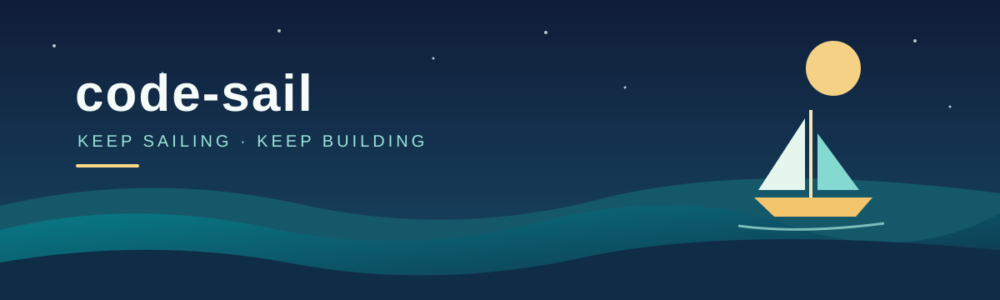

  

  <strong>用代码探索世界，记录沿途的想法与作品。</strong> 
  一次探索，一次创造，一段新的旅程。

  
  
  

## 🧭 正在航行

- 🔭 **正在做** · hellojmf
- 🌱 **最近关注** · 探索新的技术与创意

## 🗺️ 航行地图

| 航线 | 沿途风景 |
| :--- | :--- |
| 🚀 **项目名称** | 一句话介绍这个项目。 |
| 🛠️ **项目名称** | 一句话介绍这个项目。 |

## ⚓ 我的工具箱

常用的语言、框架和工具，待补充。

## 📬 捎个消息

公开联系方式和个人链接，待补充。

---

<em>Keep sailing, keep building.</em> ⛵

