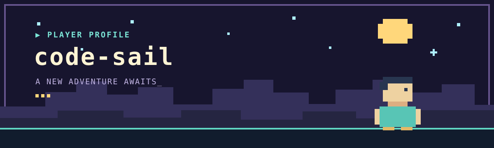

<p align="center">
  
</p>

<p align="center"><strong>🎮 一份仍在更新的游戏存档</strong><br />用代码探索新地图，把想法变成可以玩的作品。</p>

<p align="center">
  
  
  
</p>

## 🕹️ 存档信息

```text
PLAYER     季匡胤
LOCATION   代码与创意的交汇处
QUEST      正在探索新的技术与创意
```

**当前任务：** 🔭 hellojmf

## 🗺️ 关卡选择

| 关卡 | 任务简报 | 状态 |
| :--- | :--- | :--- |
 | `01` 🚀 项目名称 | 一句话介绍这个项目。 | 待解锁 |
| `02` 🛠️ 项目名称 | 一句话介绍这个项目。 | 待解锁 | 

## 🎒 装备栏


常用语言、框架和工具，待补充。

## 💾 存档点

公开联系方式和个人链接，待补充。

---

<p align="center"><code>▶ PRESS START TO EXPLORE</code><br /><sub>每一行代码，都是新地图的入口。</sub></p>
